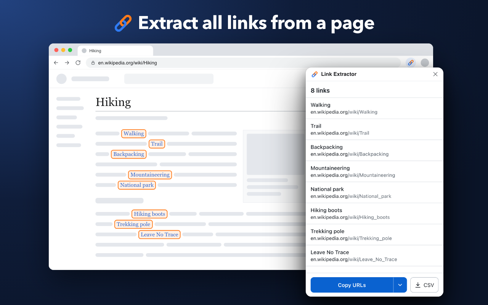

# Link Extractor

**A free Chrome extension that lists every link on the page you have open.** Click the icon, and a side panel shows all links in page order, without duplicates, with the link text next to each address. Copy them or export a CSV for Excel and Google Sheets.

[**Add to Chrome — Chrome Web Store**](https://chromewebstore.google.com/detail/link-extractor/jhkaajdkjhnfgllboflfppkhaaclfagg?utm_source=github&utm_medium=readme&utm_campaign=repo)

## What it does

- **All links of the open tab**, in the order they appear on the page.
- **No duplicates.** Repeats are merged into one row with a counter.
- **Link text** next to every address.
- **Internal or external**, plus **nofollow, sponsored, ugc** marks for SEO checks.
- **Filters** by text, domain, type (pages, files, email, phone), internal/external and rel.
- **Copy** the addresses, one per line, or **export a CSV** that opens in Excel without broken characters.
- **Links from a selection.** Select part of a page to get only the links inside it.
- **Real addresses** instead of wrapped Google, Bing and Facebook redirect links.
- **Highlight** a link on the page from the list.

## Why an extension and not an online extractor

An online extractor loads the page from its own server. It cannot see links that the page adds with JavaScript, and it cannot open pages behind your login. Link Extractor reads the tab in your browser, as you see it.

## Privacy

The list is built in your browser and your links are never sent anywhere. There is no account, and Chrome shows no access warning when you install it. Our website counts installs, low ratings and removals: see the privacy policy at link-extractor.com/privacy/.

## Links

- Website: https://link-extractor.com/
- Chrome Web Store: https://chromewebstore.google.com/detail/link-extractor/jhkaajdkjhnfgllboflfppkhaaclfagg?utm_source=github&utm_medium=readme&utm_campaign=repo

This repository hosts the website. The extension is free.
